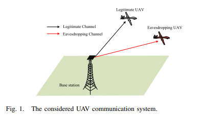
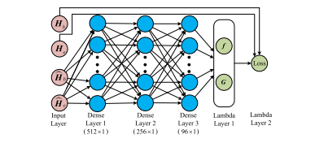
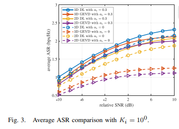
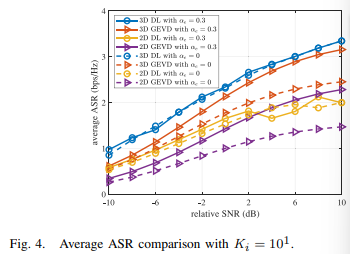
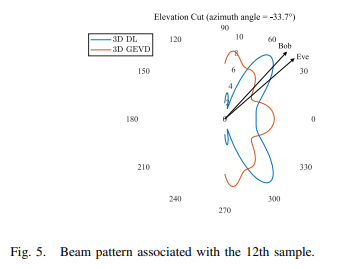
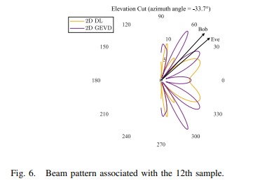
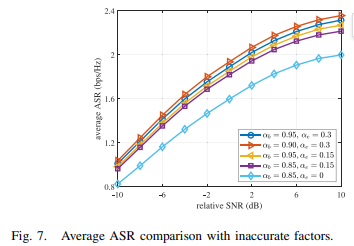

# New breakthrough in drone communication security! Deep learning-driven 3D robust beamforming solidifies the physical layer defenses[with MATLAB + Python code]

Deep learning-driven 3D robust beamforming for drone communication security: a new breakthrough!
In the era of rapid development in low-altitude economy and drone communication, the line-of-sight (LOS) characteristic of air-to-ground channels poses severe challenges to communication security. How can efficient yet secure drone communication be achieved under partial channel state information (CSI)? A study published in IEEE Wireless Communications Letters offers an innovative answer—a deep learning-based 3D robust beamforming scheme, providing a brand-new technological path for safe drone communication.

1. The core information of the paper is titled: "Deep Learning-Driven Drone System Security Communication 3D Robust Beamforming Method".
2. The abstract highlights the key aspect of beamforming as a critical technology for enhancing wireless transmission security. However, optimal design under partial CSI has always been a challenging issue in the industry. This paper proposes a three-dimensional (3D) robust beamforming method from a physical layer security perspective for drone communication systems: aiming to maximize the average confidential rate of the system, it optimizes the beamformer jointly for both legitimate drones and eavesdropping drones based on their partial CSI through a carefully designed neural network. Simulation results show that this deep learning approach achieves superior confidential rate and flexible beam direction control compared to traditional benchmark solutions, significantly enhancing the security of drone communication.
3. Introduction: Challenges and solutions for drone communication security
Drones, as important carriers of ubiquitous connectivity in 5G and beyond networks, are widely used due to their advantages in air-to-ground communication. However, their inherent line-of-sight transmission characteristics make them vulnerable to eavesdropping, presenting a bottleneck for their development.
Traditional encryption schemes can ensure security, but they struggle to adapt to the resource-constrained and energy-demanding characteristics of drones. Physical layer security techniques, which implement secure transmission through signal processing, have become a research hotspot.
Among these, 3D beamforming leverages the design dimensions brought about by different drone angles, fitting the air-to-ground communication scenarios of drones. However, existing research faces two major limitations:
1.
Perfect channel state information (CSI) assumptions are unrealistic, and in practice, only partial/imperfect CSI can be obtained;
2. 
Most research focuses on the optimization of drone base stations, neglecting the beamforming design for ground base stations.
In recent years, neural networks have demonstrated strong potential in signal processing problems, and based on this, the research team proposes a deep learning-driven 3D robust beamforming method to tackle the security communication challenges under partial CSI.
IV. Core Method: Deep Learning-Powered 3D Robust Beamforming
1. System Model Construction Research has built a communication system involving ground base stations + legitimate drones + eavesdropping drones: Ground base stations equipped with uniform planar arrays (UPA), both legitimate and eavesdropping drones equipped with uniform linear arrays (ULA); Channels consider large scale path loss and small scale Rayleigh fading, while introducing position error of eavesdropping nodes, partial CSI model, to fit the actual non-ideal communication environment.
Maximizing average confidential rate as the optimization objective, under total transmit power constraints, jointly optimize the secret signal beam vector and artificial noise beam matrix, solving the non-convex optimization problem.
2. Deep Learning Network Design The entire scheme is divided into offline training and online deployment stages:
★ Offline Training: Input perfect and partial CSI, calculate loss backward propagation with perfect CSI to let the network learn wireless channel statistical features;
★ Online Deployment: Only input partial CSI, can quickly output robust beamforming results.
The network uses three fully connected layers to extract channel features, combined with two Lambda layers to achieve power constraint satisfaction and loss function calculation respectively, using negative average confidential rate as the loss function, completing unsupervised learning, allowing the network to adapt to time-varying wireless channels.
3. Complexity and Advantages Although slightly more complex than traditional GEVD methods, this method can be accelerated by GPU computation; the core advantage lies in its robustness, capable of adapting to partial CSI and random channel variations, and compared to 2D solutions, 3D beamforming achieves more concentrated beams and fewer sidelobes, leading to better security performance.
V. Simulation Verification: Comprehensive Leading Performance Research Sets up 4×4 planar array ground base stations and 6-antenna drone terminals, comparing with four schemes of 3D deep learning, 3D GEVD, 2D deep learning, 2D GEVD, the key conclusion is obtained:
1  
Deep learning + 3D beamforming combination, the average confidential rate is optimal under different signal-to-noise ratio and Rayleigh K factor.
2  
3D Beamforming has significantly better safety performance than 2D schemes, with more precise beam direction and the ability to form null at the direction of eavesdropping nodes.
3  
The network possesses strong generalization capabilities, even if some CSI factors are not matched, the loss of confidentiality rate is minimal, and it can adapt to practical application scenarios.
VI. Conclusion and Future Prospects
Future research can be extended in two major directions:
1  
Robust Beamforming for Large-Scale Arrays, Achieving Narrower Beamwidth and More Accurate Directionality;
2  
Beamforming and drone trajectory joint design to ensure continuous safe transmission of mobile drones.
This study provides a new technical approach for low-altitude unmanned aerial vehicle communication security, and also lays the foundation for the safety assurance of integrated communication in space and ground in the 6G era.

## Images

<!-- PAYMENT_BLOCK -->

## Get this dataset

- Payment link (Stripe): [Buy now](https://buy.stripe.com/3cs8yP7sY87d0vu9AB)
- Payment QR code: 

<!-- /PAYMENT_BLOCK -->
